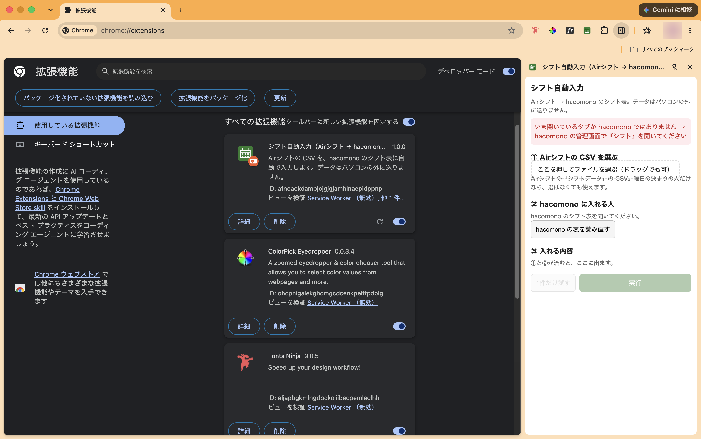
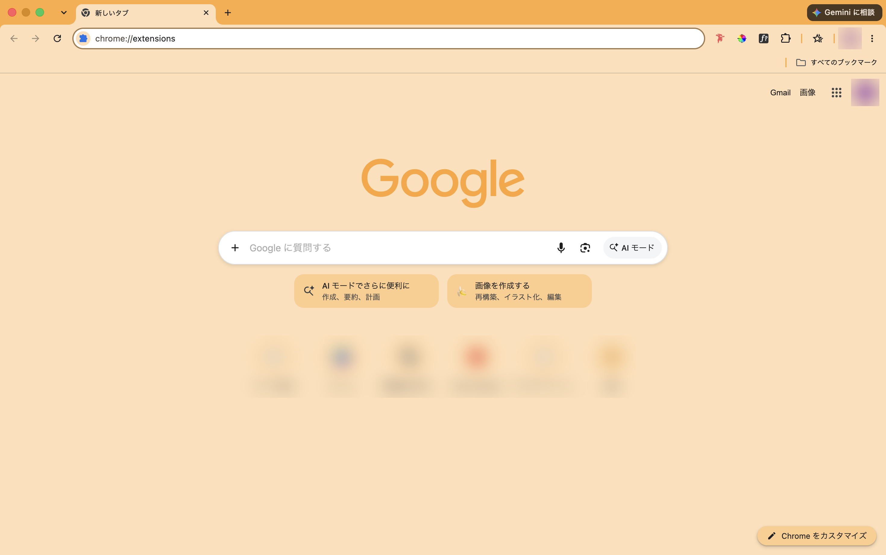
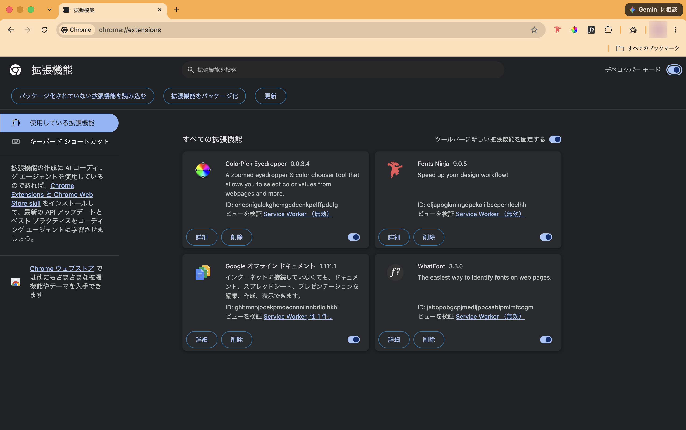
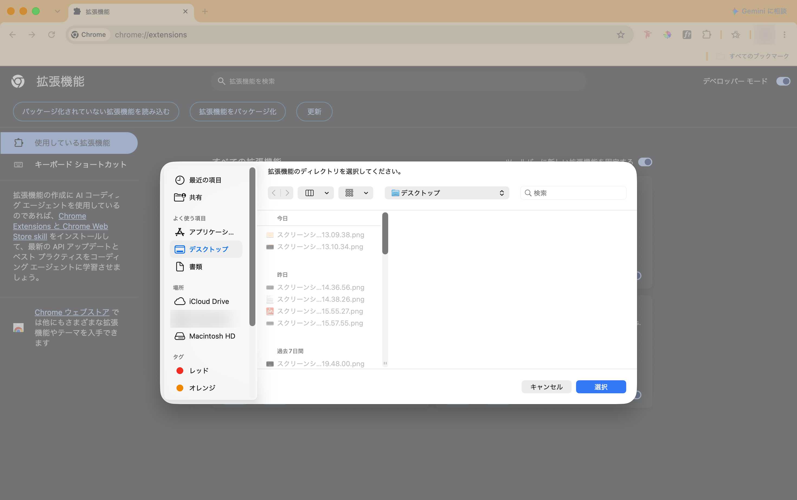
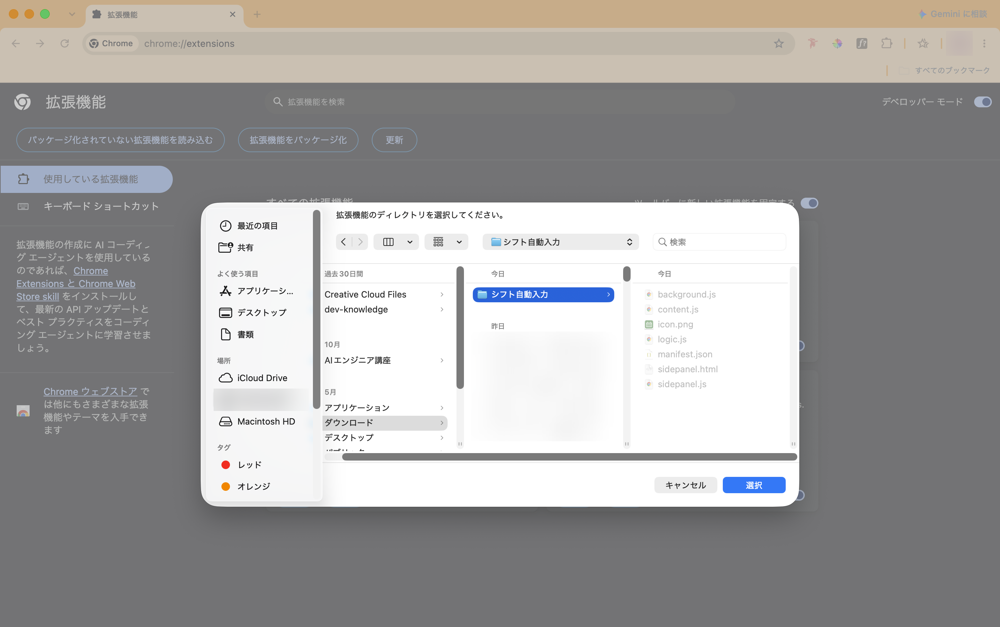
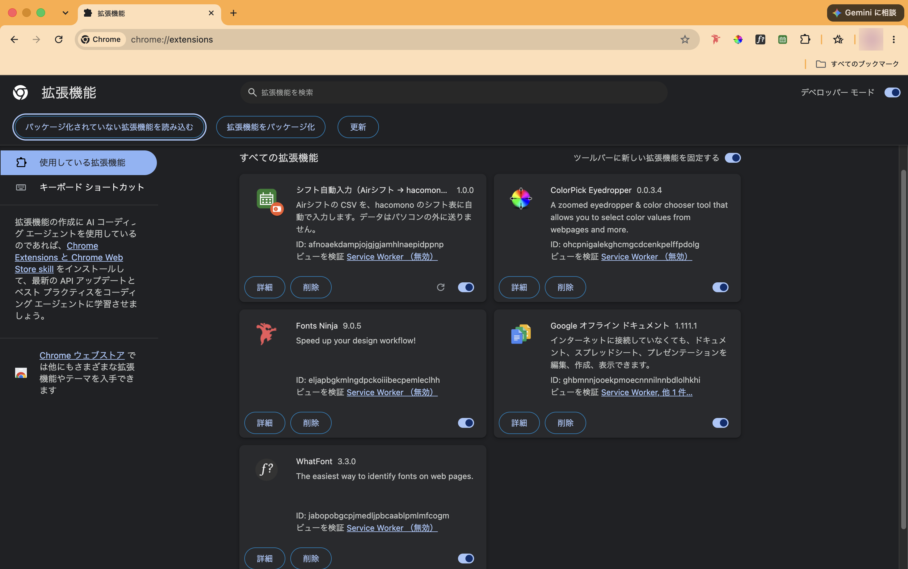
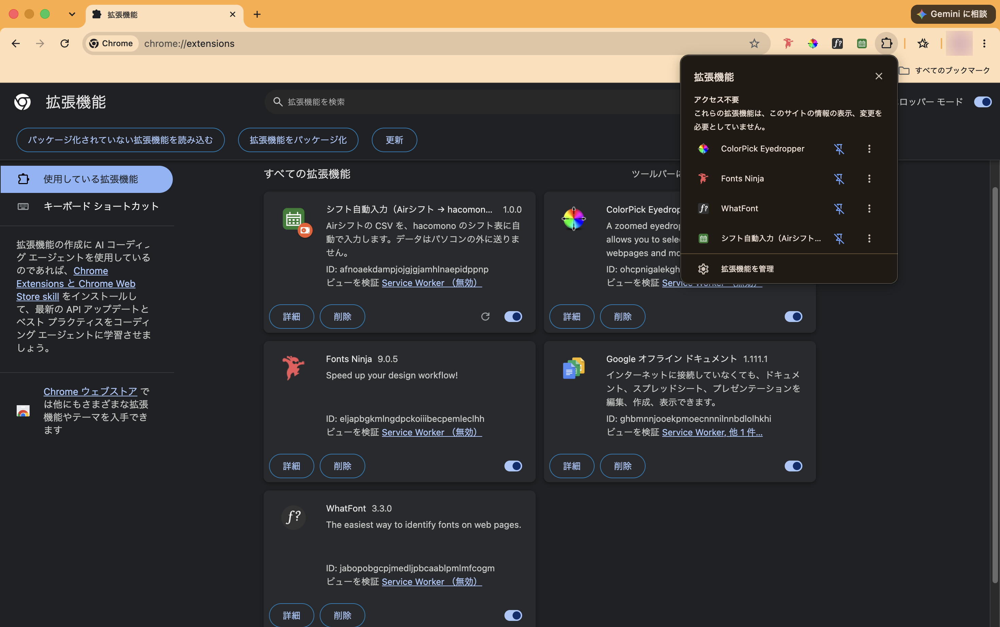

# シフト自動入力（Airシフト → hacomono）

Airシフトで作ったシフト（CSV）を、hacomono（ジムの会員・予約管理システム）のシフト表に自動で入力する Chrome 拡張機能です。

ジムの店長が毎月、トレーナー3人×約30日分を1マスずつ打ち直していた作業（30〜40分）を、**「CSV を選んで『実行』を押すだけ」（約5分）**にします。



## できること

- Airシフトの CSV を読み、hacomono のシフト表と見比べて「新しく入れる／時間を変える／同じ／要確認」の一覧を出す
- 「実行」で、出勤の日のマスに開始・終了時間を入れる（「45件中12件完了…」と進み具合が出る。途中で「止める」も押せる）
- 「1件だけ試す」で、先に1マスだけ入れて確かめられる
- CSV に出ない人（例：店長）は「曜日の決まり」（月 休／火 13:00-22:00 …）で入れる。休憩の予定ブロックも入れる。祝日は休み
- 入れたあとはマスを読み返して、CSV と同じになったかを確かめる
- 予定ブロックや、CSV で休みの日のマスには触らない（「要確認」として知らせるだけ）

## 使う技術

| 項目 | 内容 |
|---|---|
| 言語 | JavaScript |
| 仕組み | Chrome 拡張機能（Manifest V3）：サイドパネル（画面）＋コンテンツスクリプト（hacomono のページを操作）＋ `chrome.storage`（設定を覚える） |
| ライブラリ | なし |
| テスト | Node.js の `node:test`（単体テスト）、画面に出さない Chrome を DevTools Protocol で動かす自動テスト（練習用ページ・サイドパネル） |

## 安全のために

- **パソコンの外に通信しません**。シフトのデータ（名前・時間）はどこにも送りません
- 動くのは hacomono の管理サイト（`https://*.hacomono.jp/*`）だけ。使う Chrome の機能は「サイドパネル」と「覚えておく（storage）」だけです
- 秘密の鍵・パスワードは使いません（hacomono へのログインは、ふだん通り自分で行います）

## 事前準備

- Google Chrome（Windows・Mac どちらでも）
- hacomono の管理画面にログインできること
- Airシフトから「シフトデータ」の CSV をダウンロードできること

## 入れ方（最初の1回だけ）

1. 受け取った `シフト自動入力.zip` を、ダウンロードフォルダに置く
   - **Windows**：ZIP を右クリック →「すべて展開」→「展開」（ZIP のままでは選べません）
   - **Mac**：ダブルクリックするとフォルダになります
2. Chrome のアドレス欄に `chrome://extensions` と打って Enter
   
3. 右上の「デベロッパー モード」をオンにする
   
4. 左上の「パッケージ化されていない拡張機能を読み込む」を押す
   
5. 「ダウンロード」→「シフト自動入力」フォルダを1回押して選ぶ →「フォルダーの選択」（Mac は「選択」）
   - Mac で左の列に「ダウンロード」が無いときは、家のマーク → ダウンロード の順に開く
   
6. 「シフト自動入力（Airシフト → hacomono）」のカードが出たら完了
   
7. ツールバーに緑のカレンダーのアイコンが見えないときだけ：パズルのアイコン → ピン📌を押す
   

**こうなったら**

| 出たこと | どうすればよいか |
|---|---|
| 「マニフェスト ファイルが見つからないか、読み取れません」 | ZIP のままか、違うフォルダを選んでいます → 1 の「すべて展開」からやり直し、「シフト自動入力」フォルダを選んでください |

## 使い方（毎月）

1. Airシフトで翌月の「シフトデータ」の CSV をダウンロードする
2. Chrome で hacomono の管理画面 →「シフト」を開き、入れる月の表にする
3. 緑のカレンダーのアイコンを押す → 右にサイドパネルが開く
4. ① で CSV を選ぶ（ドラッグでも可）
5. ② で、人ごとに「Airシフトの CSV から／曜日の決まりで／入れない」を選ぶ（次の月からは覚えています）
6. ③ の一覧を確かめ、入れたくない日はチェックを外す
7. 「1件だけ試す」→ hacomono の表でそのマスが合っていたら「実行」

**エラーが出たとき**：メッセージに「何が起きたか → どうすればよいか」が出ます。

| 出たこと | どうすればよいか |
|---|---|
| いま開いているタブが hacomono ではありません | hacomono の管理画面で「シフト」を開く |
| hacomono のページとつながりません | hacomono のページを再読み込み（Windows は F5、Mac は ⌘R）してから、もう一度押す |
| Airシフトのシフトデータではないようです | Airシフトの「シフトデータ」の CSV を選び直す |
| hacomono は 12月、ファイルは 1月 です | hacomono の表を CSV と同じ月にする |
| ログインが切れたかもしれません | ログインし直してもう一度「実行」（済んだマスは「同じ」になるので飛ばされます） |

## 秘密ファイルについて

この拡張機能は API の鍵やパスワードを使わないので、用意する秘密ファイルはありません。

ただし、Airシフトの CSV と hacomono の画面にはスタッフの名前が入っています。GitHub に載せているのは名前を「スタッフA〜E」に置き換えた練習用のデータ（`samples/`）と、本物の作りに似せた練習用ページ（`mock/`）だけです。

## 開発する人向け

```bash
node --test "tests/*.test.js"   # 単体テスト（CSV を読む・入れる内容を決める）
node tests/e2e_mock.js          # 練習用ページに content.js で入力して照らし合わせる（約2分）
node tests/sidepanel_ui.js      # サイドパネルの画面（止める・エラー表示・進み具合）
```

- 配る ZIP は `extension/` の中身をそのまま入れる（ZIP の中にフォルダを作らない。Windows の「すべて展開」でフォルダが二重になるため）
- hacomono の画面が変わったら、`extension/content.js` の先頭の設定（ボタンの探し方・待ち時間）を直す
